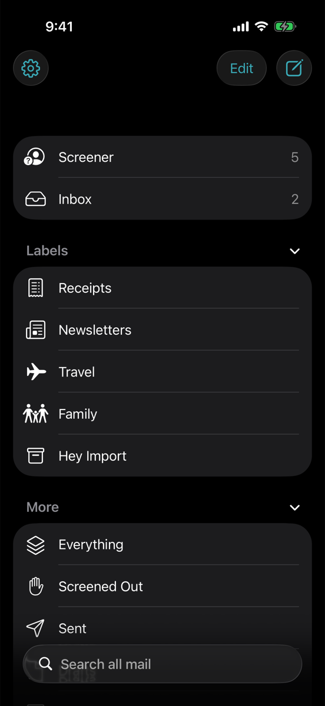
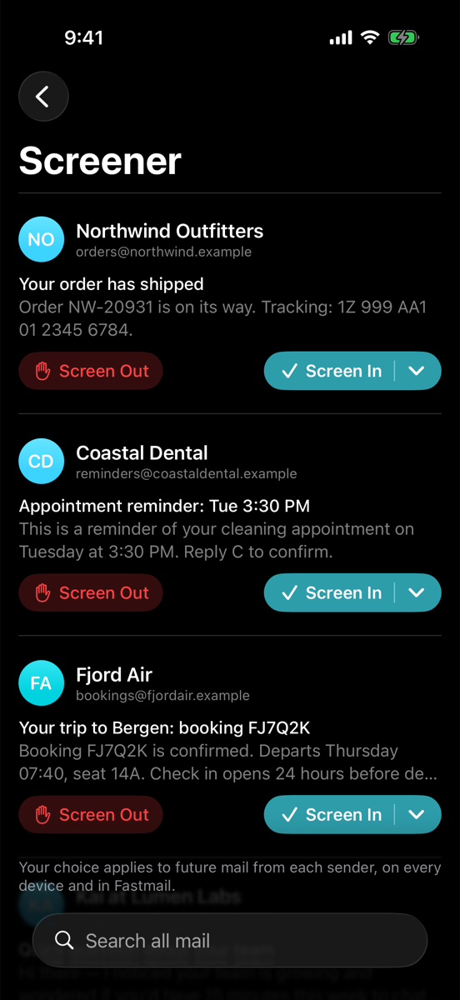
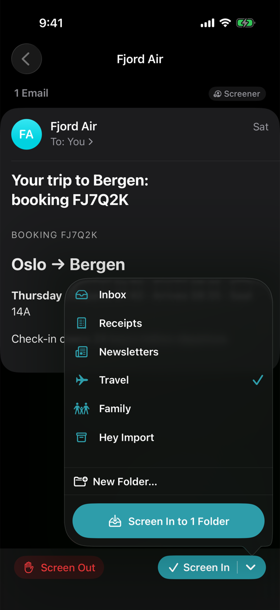
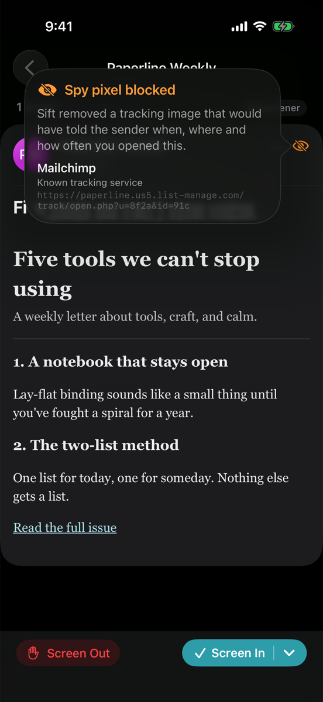
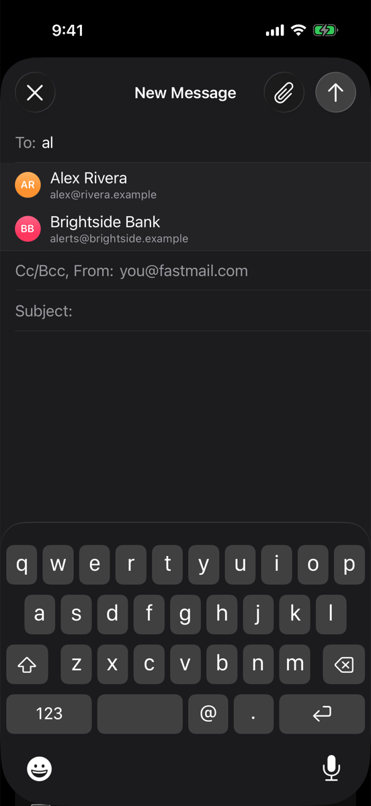
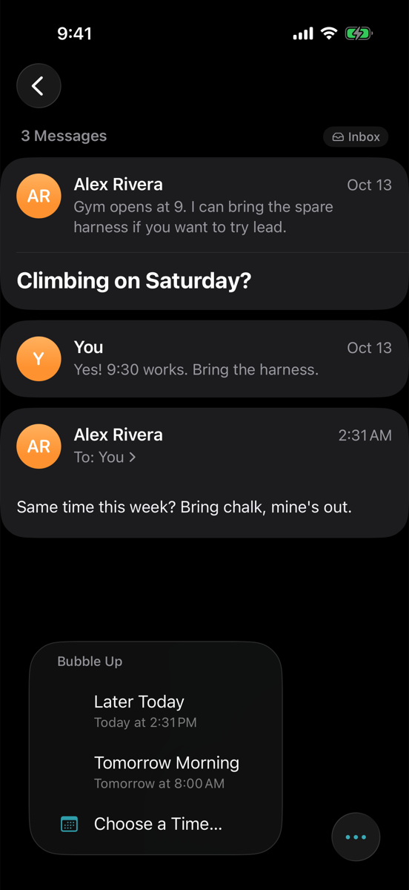
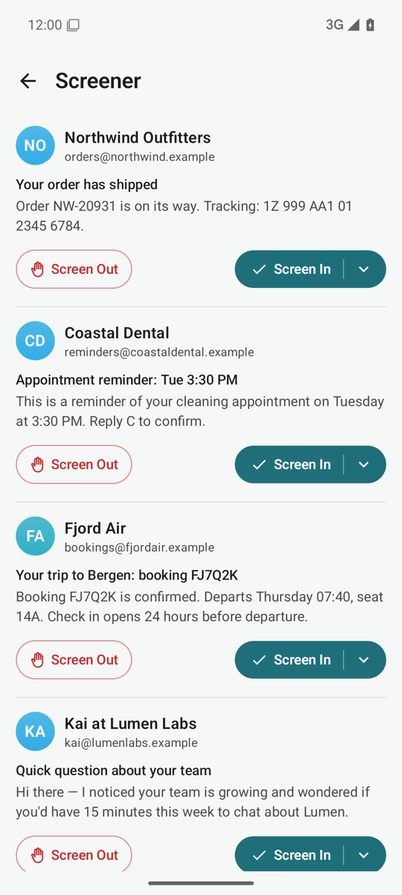
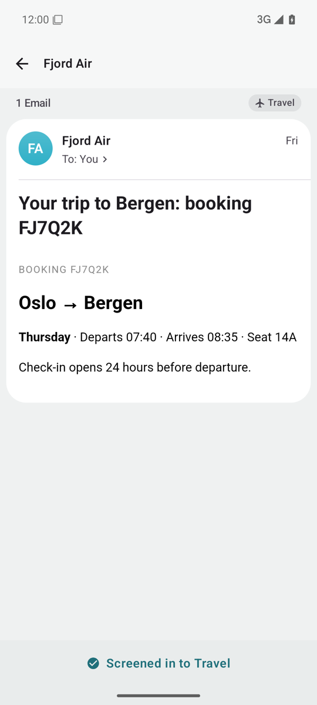
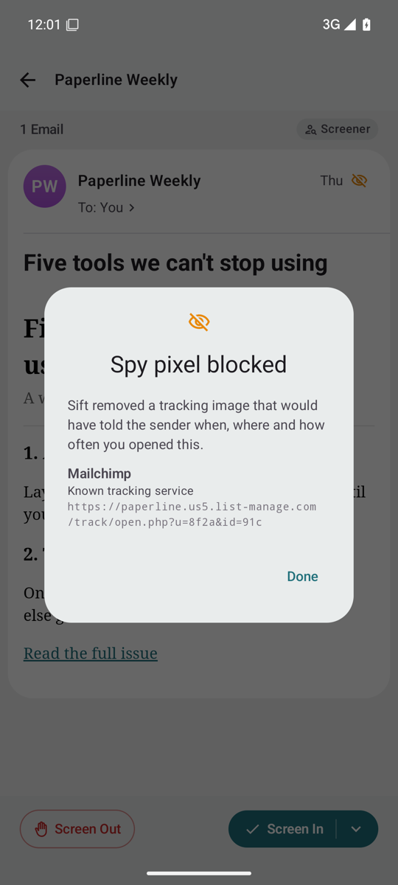
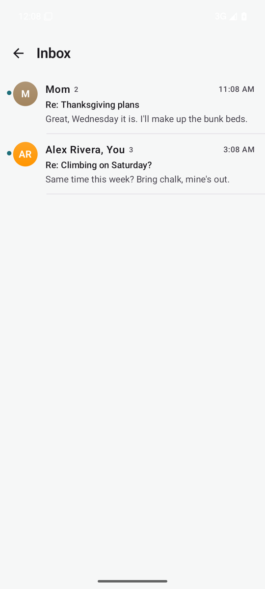

# Sift

A calm, Hey-style iOS and macOS client for Fastmail. There's also an [Android version](android/README.md).

- **Screener.** Mail from new senders waits in the Screener. When you screen a sender in, you pick one or more labels for their mail; when you screen them out, their mail goes to Screened Out.
- **Everything.** One view of all mail, including Spam and Trash.
- **Spy-pixel blocking.** Tracking pixels are removed, and each message names the service that tried to track you.
- **Search.** Instant results from the local index, plus complete results from Fastmail's server-side search.
- **Per-sender alerts and badge.** Both are off for everyone by default; you turn them on for individual senders.

## Screenshots

These show the sample mail from demo mode.

### iPhone

<table>
  <tr>
    <td align="center" valign="top"><br>Mailboxes, with an icon for each label</td>
    <td align="center" valign="top"><br>The Screener</td>
    <td align="center" valign="top"><br>Screening a sender in to Travel</td>
  </tr>
  <tr>
    <td align="center" valign="top"><br>A blocked spy pixel</td>
    <td align="center" valign="top"><br>Compose, with address suggestions</td>
    <td align="center" valign="top"><br>Bubble Up</td>
  </tr>
</table>

### Android

<table>
  <tr>
    <td align="center" valign="top"><br>The Screener</td>
    <td align="center" valign="top"><br>Screened in to Travel</td>
    <td align="center" valign="top"><br>A blocked spy pixel</td>
    <td align="center" valign="top"><br>Inbox</td>
  </tr>
</table>

## Getting started

1. In Fastmail, go to **Settings → Privacy & Security** and create an API token with **Email**, **Email submission**, and **Contacts** access.
2. Open `Sift.xcodeproj` and run the **Sift** scheme on an iPhone, an iPad, or "My Mac".
3. Paste the token. Sift keeps it in iCloud Keychain, so your other devices can use it.

### Installing on your Mac

To keep a normal copy in `/Applications` (for Spotlight, the Dock, and **Open Sift at login**):

- **Terminal:** `scripts/install-mac.sh` builds Release, replaces `/Applications/Sift.app` and launches it. Add `--no-open` to skip the launch.
- **Xcode:** choose the **Sift (Install to Applications)** scheme and **My Mac**. ⌘B builds Release and installs it; ⌘R also launches the installed copy.

Either way, a running copy of Sift is quit first, and each install is logged to `~/Library/Logs/Sift-install.log`. The plain **Sift** scheme still builds and debugs from DerivedData as usual.

### Default email app

Sift handles `mailto:` links: each one opens a new message with the To, Cc, Bcc, subject and body from the link filled in.

- **Mac:** Sift ▸ Settings ▸ General ▸ **Make Sift the Default Email App**. macOS asks you to confirm. Mail's **Settings ▸ General ▸ Default email reader** works too.
- **iPhone and iPad:** apps can only become the default mail app with Apple's `com.apple.developer.mail-client` entitlement. You request it from Apple; it isn't a checkbox in Xcode. Once it's granted, add the entitlement to the Sift target and choose Sift in **Settings ▸ Apps ▸ Default Apps ▸ Email**. The link handling is already in place.

To try Sift without an account, tap **Explore with sample mail** or launch with the `-demo` argument. Demo mode runs against an in-process fake of Fastmail's API (`SiftKit/Sources/SiftKit/Demo`).

## How Sift maps onto Fastmail

Everything Sift does is stored in Fastmail, so the Fastmail web app stays usable.

| Sift | Fastmail |
| --- | --- |
| Labels | Mailboxes. A message can carry several. |
| Screener / Screened Out | Two mailboxes Sift creates on first launch. |
| Sender decisions | Contact groups in your default address book: `Sift: Screened In`, `Sift: Screened Out`, `Sift: Notify`, `Sift: Badge`, and one `Sift label: <name>` group per label. Senders are stored as email-address members (`mailto:`), so no contact card is created per sender. Fastmail doesn't let apps create a separate address book. A contact you drag into one of these groups in Fastmail counts too. |
| Label icons | A note on the label's `Sift label: <name>` group, such as "Sift icon: airplane". Until you pick one, Sift guesses from the label's name. Right-click (or long-press) a label in the sidebar and choose **Change Icon…**. |
| "Already sorted" marker | The `$siftrouted` keyword. Any device that sees new mail can sort it, but each message is sorted only once. |

### Screener rules

- Mail that arrived before you connected is never screened.
- People in your contacts, and people you've sent mail to, skip the Screener. Sift records them as screened in.
- Each new Inbox message is handled one of three ways:
  - **Screened-in sender:** filed into that sender's labels (Inbox if none).
  - **Screened-out sender:** moved to Screened Out and marked read.
  - **Anyone else:** moved to the Screener.
- Sorting happens on whichever device is running Sift. On a Mac with **Open Sift at login** on, it happens within seconds. Until a device runs, new mail sits in the Fastmail Inbox.
- Because decisions are contact groups, you can also add a Fastmail rule that sorts mail on the server. Fastmail rules can match "sender is (not) in contact group".

## Learning from your existing filing

- **Suggested rules** (Settings → Tools, or the wand in Senders): looks at where you've already filed each sender's mail and proposes rules. A sender is suggested for a folder when at least half their mail is there. Mostly Inbox or Archive becomes "screen in to Inbox", and mostly Spam becomes "screen out". Suggestions are grouped by folder so you can untick a whole group. Rules apply to new mail only. Folders with "import" in the name are ignored because they aren't sorted yet.
- **Sort a folder** (Settings → Tools, or "…" on any of your folders): reads every message in the folder from Fastmail and files each one.
  - **Rules first:** the sender's screening rule decides, if there is one.
  - **Then history:** otherwise, wherever you've filed that sender's other mail.
  - **Your own mail:** goes to Sent, including mail from an old address. That address is detected as the one most of the folder's mail was sent to.
  - **Unmatched:** goes to the Inbox, as does mail from senders screened in without a folder. Sorted mail is marked as already screened, so it doesn't then land in the Screener.

  You see a preview first: open a destination to see its senders and why their mail goes there, then a sender to see the messages. Once the folder is empty, Sift offers to delete it.

## Writing mail

- **Compose** works like Mail: To, Cc and Bcc as address tokens with suggestions from people you've written to or heard from, a Subject line, and the message. On iPhone, Cc, Bcc and From fold into one line until you tap it.
- **Attachments** come from Photos or Files, or by dropping files on the window on the Mac. They upload as soon as you add them; iPhone photos are sent as JPEG. Forwarding brings the original's attachments along.
- **Drafts** live in Fastmail's Drafts mailbox. Sift saves after a pause in typing, when the app goes to the background, and when you close a message (iPhone asks Delete or Save). Open a draft and tap **Edit Draft** to carry on.
- **Undo Send** (Settings → Sending; off, 10, 20 or 30 seconds) holds each sent message. When Fastmail supports delayed sending, it holds the message itself, so it still goes if Sift quits. Otherwise Sift keeps it in Drafts for the delay, then sends it.
- Your Fastmail identity's plain-text signature is added to new messages, replies and forwards.

## Bubble Up

Like HEY's: tap the bubble button on any conversation (or right-click it on the Mac) and pick Later Today, Tomorrow Morning, This Weekend, Next Week or a time of your own.

- **How it works:** Sift sends you a note with the conversation's subject and threading headers, and Fastmail holds it until then (its delayed sending, the same thing Undo Send uses). When it arrives, it lands in the same conversation, so the conversation moves to the top, in Fastmail's own apps too.
- **In Sift:** the note is hidden, marked with the `$siftbubble` keyword. The original message turns unread again and keeps its own date, and the list shows "Bubbled up".
- **Before it happens:** the conversation shows when it will bubble up. Pick "Don't Bubble Up" to cancel, or choose another time. Pending Bubble Ups are read back from Fastmail, so every device knows about them.
- **Limit:** it needs Fastmail to hold mail for that long; Sift says so if a time is too far out.

## Search syntax

```
invoice from:stripe -subject:"payment failed" has:attachment after:30d in:receipts
from:alex OR from:sam climbing
```

- **Fields:** `from:`, `to:`, `cc:`, `subject:`, `body:`
- **Labels:** `in:` / `label:`
- **Flags:** `has:attachment`, `is:unread`, `is:read`, `is:pinned`
- **Dates:** `before:` / `after:` take a date (`2026-03-01`) or a relative age (`7d`, `2w`, `3m`, `1y`)
- **Operators:** `-` negates a term, `"quotes"` match a phrase, and uppercase `OR` joins alternatives

The same parsed query runs against SQLite FTS5, which gives prefix matches as you type over cached mail. It also runs through JMAP `Email/query` with `SearchSnippet/get`, which searches your whole account including attachment contents.

## Spy pixels

`TrackerDetector` removes an image if any of these is true:

- it comes from a known tracking service (about 60 rules in `TrackerList.swift`, covering Mailchimp, SendGrid, HubSpot, Amazon SES, Mailgun, Substack, Superhuman and more);
- it's tiny (1×1, or 0 in either dimension);
- it's hidden with CSS;
- it has no declared size and a URL that looks like a tracking beacon.

Messages also render with defenses beyond pixel removal:

- **Script and network controls:** JavaScript is off. A WebKit content blocker stops known trackers at the network layer, including CSS backgrounds. Scripts, iframes and remote stylesheets are stripped.
- **Links and navigation:** links open in your browser. Nothing navigates inside the reader.
- **Remote images:** **Load remote images** in Settings can turn them off entirely. You can still load them for one message at a time.

## Notifications

- **Default:** alerts and badges are off. Turn them on per sender in sender settings (tap a sender's avatar).
- **Mac:** alerts arrive live while Sift is running. Sift holds Fastmail's push (EventSource) connection open.
- **iPhone:** alerts depend on iOS background refresh, which can be late. Real-time iOS push needs a small relay server, because Fastmail doesn't offer push subscriptions to third-party apps. The relay would hold the EventSource connection, read the rules from the Sift contact groups, and send APNs alerts.

## Layout

```
Sift/                      SwiftUI app (iOS + macOS, one target)
SiftKit/                   Swift package with all the logic, unit-tested
  JMAP/                    Hand-rolled JMAP client: session, method calls, EventSource
  Store/                   GRDB/SQLite cache, FTS5 index, observable queries
  Sync/                    SyncEngine (sync, routing, mutations, search, sending)
  Screener/                Router (pure routing rules) and ContactsRuleStore
  Privacy/                 TrackerDetector, tracker list, content-blocker rules
  Search/                  Query parser → JMAP filter and SQL
  Demo/                    Fake JMAP server and sample mailbox
```

Run the tests. `~/Documents` is iCloud-synced, which breaks test-bundle signing, so build outside it:

```bash
cd SiftKit && swift test --scratch-path ~/Library/Caches/Sift/SiftKit-build
```

## Not yet verified or built

- **Real account:** sign-in, the scope check and mailbox creation work against Fastmail. Saving the first screening rule hasn't been tried yet. It depends on Fastmail accepting email-address (`mailto:`) group members, and if it doesn't, Sift says so and leaves your mail and rules unchanged.
- **Compose:** plain text only, with no formatting.
- **Offline:** changes made offline aren't queued for later.
- **OAuth:** no OAuth sign-in yet; you paste an API token.
